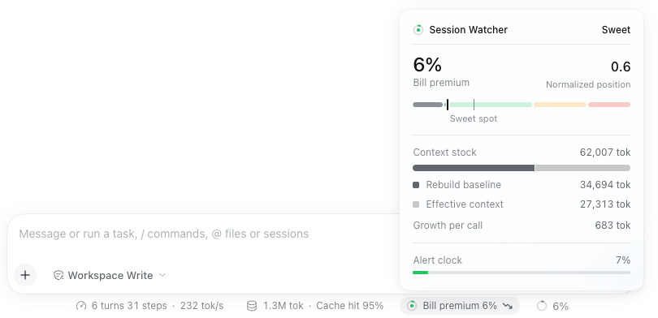
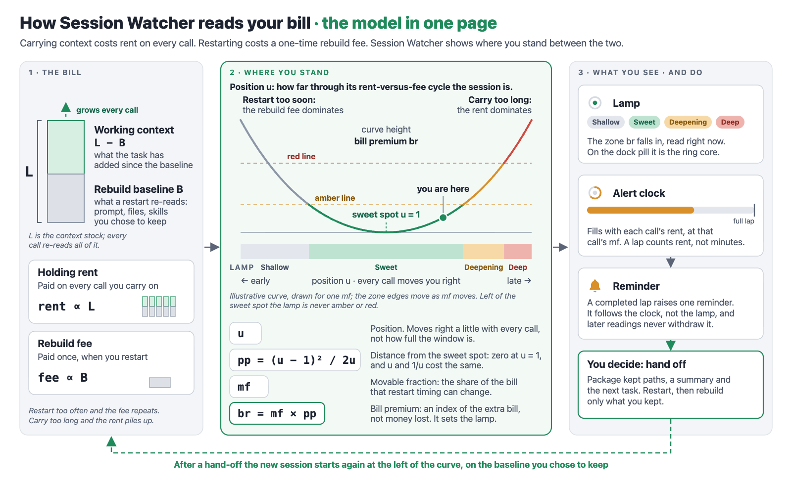
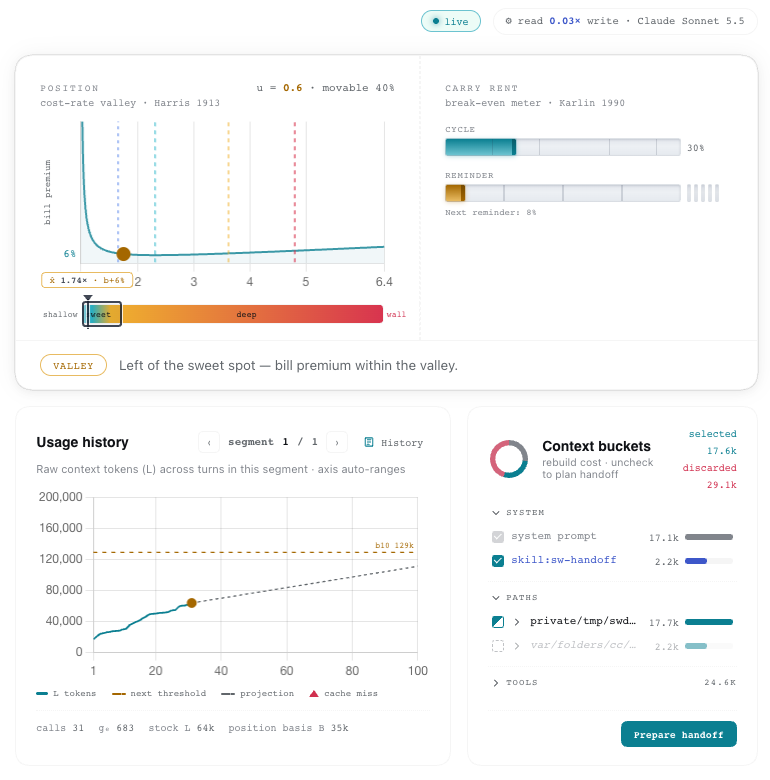
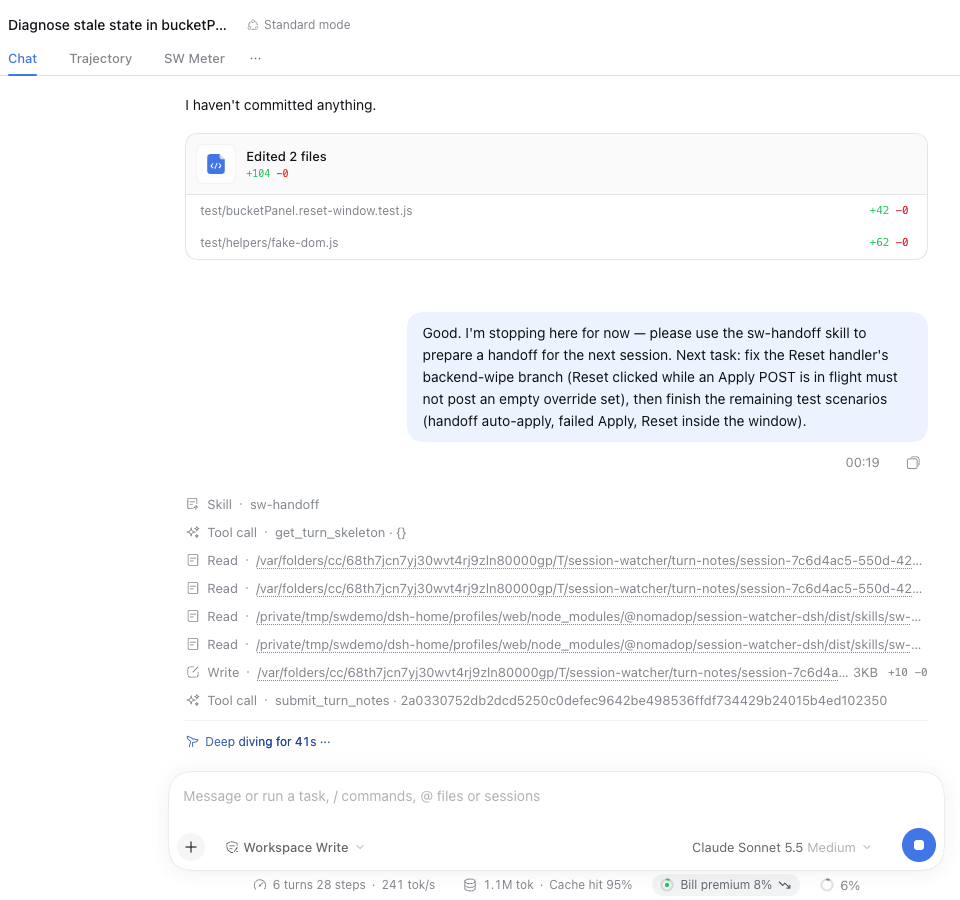
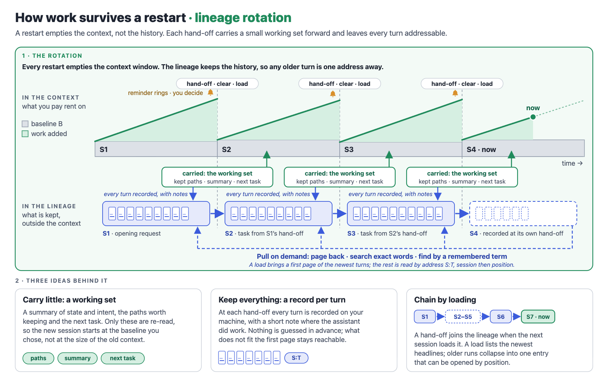

# @nomadop/session-watcher-dsh

[中文](README.md) | English

> Unofficial community plugin, maintained independently of DeepSeek. DeepSeek has not reviewed or endorsed it.

[Session Watcher](https://github.com/nomadop/session-watcher) inside DeepSeek Harness (DSH): it measures whether the context a session carries is still worth carrying, shows the answer in the Web UI, and carries only what you choose across a restart.



The pill below the composer is the **dock**: a lamp, the bill premium and an alert clock. Its popover places the session on the position track and splits the context stock into the rebuild baseline and the work above it.

## Install

```bash
dsh plugin --profile web add @nomadop/session-watcher-dsh
```

`dsh web` boots the `web` profile; add the plugin to the profile you run. It needs DSH 0.2.2-rc.1 or later.

The package registers its own `sw_event_read` tool, which reads one event of a session in the caller's directory back as the verbatim text of its messages, tool calls and tool results; nothing else needs mounting for it. The raw event record stays with DSH's optional native `session_event_read`.

An optional pi-ai adapter entry, `@nomadop/session-watcher-dsh/pi-ai`, marks the end of the last inner-compaction carrier for the provider's prompt cache. It is off unless a profile mounts it in place of the Harness's `llm-pi-ai` plugin. It takes no configuration of its own: it reads the turned-off `llm-pi-ai` row's provider dictionary, as the Loader composes it, once at startup, so the dictionary stays in one place and an edit applies at the next start, and Session Watcher's Settings page reports when it cannot use that row. While it is mounted the Models page can neither submit edits to its routes nor declare a custom provider; the [DSH plugin docs](https://nomadop.github.io/session-watcher/docs/dsh/) give the patch layer to use and how to manage the routes then, and `vendor/dsh-llm-pi-ai/UPSTREAM.md` records what it vendors and how to remove it. A profile that holds the activation as an installed bundle, the official `@nomadop/session-watcher-dsh-carrier-cache` (`carrier-cache/` in the repository) or a local `@local/sw-carrier-cache-web`, can switch it from Session Watcher's Settings, owner only; the official bundle carries the same adapter entry, its row naming its own package, and a local bundle's row names this package's entry. Where neither is installed, the first switching on installs the official one after a confirmation, and an official bundle installed before it carried the adapter does not update with this package: update it first on the Plugins page, then this package. A second switch sits under it for the OpenAI Responses breakpoint, which is off until chosen and which the endpoint may reject, and the monitor's call overview records what the entry did for each summary request; those docs give both.

## The idea

A session pays rent on the context it carries with every call, and pays a rebuild fee once when it restarts. The position `u` says which is cheaper: left of the sweet spot the rebuild fee dominates, right of it the rent does. The bill premium `br` indexes how far the bill sits above ideal restart timing, the lamp reads it in four zones (amber and red appear only right of the sweet spot), and the alert clock completes a lap each time enough rent has accumulated.



The curve is a schematic, not a measurement. To see real curves without installing anything, the [online demo](https://nomadop.github.io/session-watcher/demo) replays an anonymized session on the standalone dashboard; it is a dashboard replay, not the DSH interface.

## The SW Meter tab



The **SW Meter** tab in the conversation view shows the position chart and its verdict, the carry-rent bars, the usage history and the context buckets. In the bucket panel you check or uncheck files, skills and tools to preview where the session would sit before you decide what to keep.

## Hand off and keep going

1. Ask the agent to use the `sw-handoff` skill. It picks only the files and skills the next task needs in hand, writes a summary and the next task, and answers with a token.
2. Type `/sw-continue` in the Web composer. It clears the session in place and loads the newest handoff this session prepared.
3. The agent carries on from the next step, unless the task left a question open. The kept files are read from disk as they are now; the summary, the latest lineage headlines and the newest turns come back with the handoff.



`/sw-load [token]` loads a handoff into the session it is typed in, without clearing it, and waits for your confirmation before work resumes.

Clearing does not discard the history. Each turn stays recorded, and the agent can page, search and look up earlier sessions on demand.



## Data and limits

- The plugin reads the session event log of the DSH host it loads into, and the files that log names. It writes its state under `~/.session-watcher`, which it shares with the Claude Code plugin; a handoff in preparation also keeps its turn notes as working files in the system temp directory. The plugin uploads nothing and has no telemetry; what the agent sends to its model provider is the host's usual traffic, handoff text included.
- The dock only observes. The tab also applies keep/discard overrides and saves price overrides, which reprice every session of the host that runs that model; neither changes the conversation. `/sw-continue` and `/sw-load` change the session, and both run only while the agent is idle. `/sw-continue` leaves the session untouched when it has prepared no handoff or when its newest handoff predates the latest context reset.
- A handoff summary is written by the agent and can leave things out. `/sw-load` waits for you to confirm the state it loads; `/sw-continue` carries on from the next step without waiting, so read the summary first.
- The tab and the dock are supported on `dsh web`. The DSH Desktop shell is unverified. The commands work from the Web composer only, not over ACP, in a headless run or from an SDK.
- The readings model the cost of a prompt-cached context. They are not a judgement of task quality and not a promise of savings.

## Links

- [DSH plugin docs](https://nomadop.github.io/session-watcher/docs/dsh/): the profile to add it to, what the tab and the dock show, and handoffs that cross between the two hosts.
- [Guarantees](https://nomadop.github.io/session-watcher/docs/guarantees/): the tools, and what each host supports.
- [Paper](https://doi.org/10.5281/zenodo.21236704): *Context Is Inventory: A Rent-or-Buy Model for Prompt-Cached LLM Sessions*.
- [Source and issues](https://github.com/nomadop/session-watcher).
