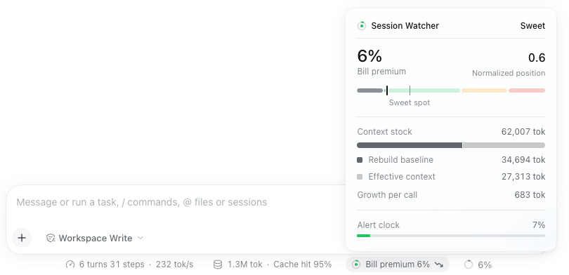
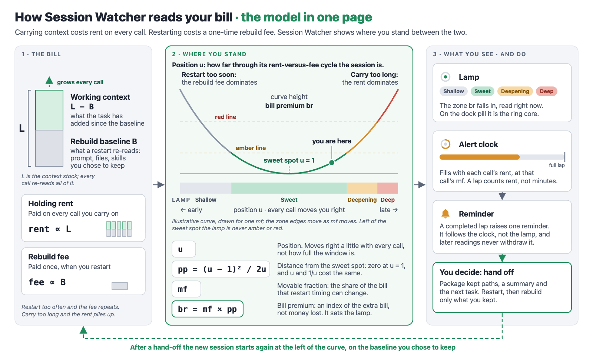
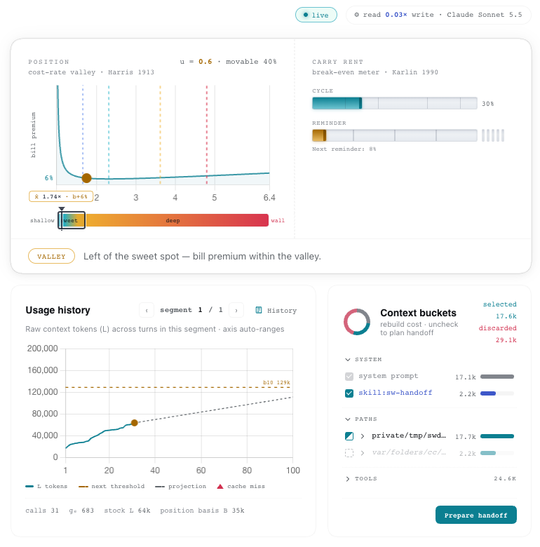
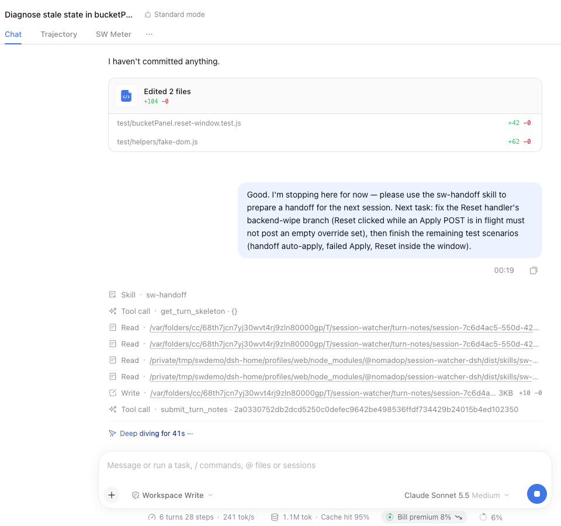
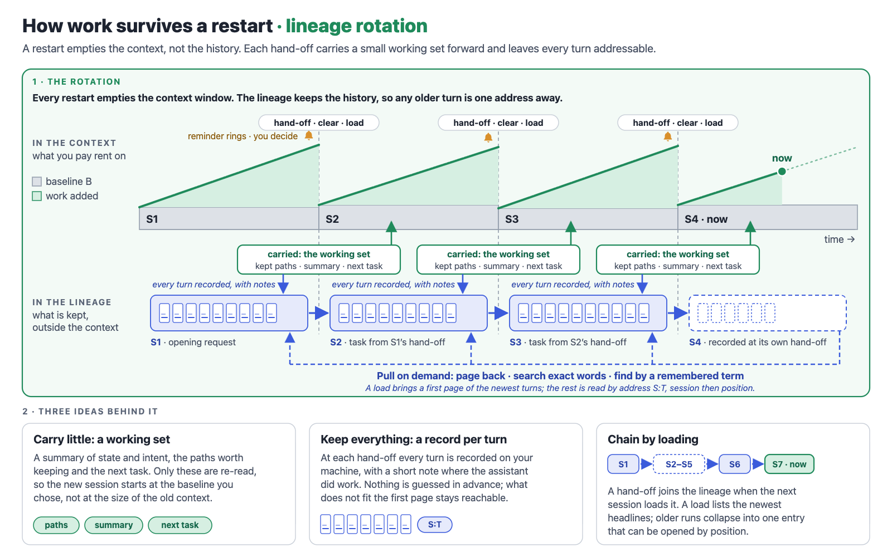

# @nomadop/session-watcher-dsh

中文 | [English](README.en.md)

> 非官方社区插件，独立于 DeepSeek 维护，未经 DeepSeek 审核或认可。

在 DeepSeek Harness（DSH）里运行 [Session Watcher](https://github.com/nomadop/session-watcher)：它衡量会话携带的上下文是否还值得继续携带，把结论显示在 Web 界面上，并在重启时只带走你选定的内容。



输入框下方的小胶囊是 **dock**：一盏状态灯、账单溢价和提醒时钟。它的弹层把会话标在位置轨道上，并把上下文存量拆成重建基线和工作上下文。

## 安装

```bash
dsh plugin --profile web add @nomadop/session-watcher-dsh
```

`dsh web` 启动的是 `web` profile；请把插件加到你实际运行的 profile。需要 DSH 0.2.2-rc.1 或更高版本。

本包自带 `sw_event_read` 工具，把调用方所在目录下某个会话的一个事件中的消息、工具调用与工具结果按原文读回；无需另外挂载。原始事件记录仍由 DSH 可选的原生 `session_event_read` 读取。

可选的 pi-ai 适配器入口 `@nomadop/session-watcher-dsh/pi-ai` 会为 provider 的 prompt cache 标记最后一个 inner compaction carrier 的末尾。只有 profile 用它替换 Harness 的 `llm-pi-ai` 插件时才生效。它没有自己的配置：启动时读取一次已关闭的 `llm-pi-ai` 行经 Loader 组合后的 provider 字典，字典因此只维护在一处，修改在下次启动时生效；无法使用该行时，Session Watcher 的设置页会给出提示。挂载期间，模型页既不能提交对其路由的修改，也不能声明自定义 provider；应使用的 patch 层和届时如何管理路由见 [DSH 插件文档](https://nomadop.github.io/session-watcher/docs/dsh/)，`vendor/dsh-llm-pi-ai/UPSTREAM.md` 记录了它 vendor 了什么以及如何移除。若 profile 已把这一激活作为已安装的 bundle 持有，即官方的 `@nomadop/session-watcher-dsh-carrier-cache`（仓库中的 `carrier-cache/`）或本地的 `@local/sw-carrier-cache-web`，就可以在 Session Watcher 设置中切换（仅限 owner）。官方 bundle 自带同一个适配器入口，行里指向它自己的包；本地 bundle 的行指向本包的入口。两者都未安装时，首次开启会在确认后安装官方 bundle；已安装的旧版官方 bundle 不会随本包自动更新，须先于本包在插件页更新。该开关之下另有一个 OpenAI Responses 缓存断点开关，开启前保持关闭，端点也可能拒绝它。SW事件（monitor）的调用概览会记录该入口对每次摘要请求做了什么。这两点同样见上述文档。

## 思路

会话的每次调用都要为它携带的上下文付租金，重启时则一次性付重建费。位置 `u` 说明哪种更便宜：甜点左侧重建费占主导，右侧租金占主导。账单溢价 `br` 衡量账单比在理想时机重启时高出多少，状态灯把它分成四个区（「渐深」和「偏深」只出现在甜点右侧），租金每累积到一定量，提醒时钟就走完一圈。



这条曲线是示意图，不是测量结果。想不安装就看到真实曲线，可以打开[在线演示](https://nomadop.github.io/session-watcher/demo)：它在独立 dashboard 上回放一个匿名会话，是 dashboard 回放，不是 DSH 界面。

## SW Meter 标签页



对话视图里的 **SW Meter** 标签页（中文界面为「SW仪表」）显示位置图及其结论、携带租金柱、用量历史和上下文分桶。在分桶面板里勾选或取消文件、skill 和工具，可以在决定保留什么之前预览会话会落在哪里。

## 交接并继续

1. 让 agent 使用 `sw-handoff` skill。它只挑出下一个任务要用到的文件和 skill，写好摘要和下一个任务，并返回一个 token。
2. 在 Web 输入框里输入 `/sw-continue`。它原地清空会话，并加载本会话准备的最新一份交接。
3. agent 用一句话说明它接着做什么，然后继续，除非任务还留着一个待回答的问题。保留的文件按磁盘上的当前内容读取；摘要、最近的 lineage 标题和最新的几轮对话随交接一起回来。



`/sw-load [token]` 则把交接加载进输入它的会话，不清空会话，并等你确认后再恢复工作。

清空不会丢掉历史。每一轮都留有记录，agent 可以按需翻页、搜索和查阅更早的会话。



## 数据与限制

- 插件读取它所加载进的 DSH 主机的会话事件日志，以及日志里提到的文件。它把状态写在 `~/.session-watcher` 下，与 Claude Code 插件共用；准备中的交接还会把它的轮次笔记作为工作文件放在系统临时目录。插件不上传任何内容，也没有遥测；agent 发给模型 provider 的内容是主机的常规流量，包括交接文本。
- dock 只观测。标签页还会应用保留/丢弃的覆盖项并保存价格覆盖项，价格覆盖项会让主机上所有运行该模型的会话按新价格重新计价；两者都不改动对话本身。`/sw-continue` 和 `/sw-load` 会改动会话，且都只在 agent 空闲时运行。本会话没有准备交接，或其最新交接早于最近一次上下文重置时，`/sw-continue` 不会改动会话。
- 交接摘要由 agent 撰写，可能有遗漏。`/sw-load` 会等你确认它加载的状态；`/sw-continue` 只留一句说明就继续，所以请读那句说明。
- 标签页和 dock 支持 `dsh web`，DSH Desktop 外壳未经验证。命令只能在 Web 输入框里使用，不支持 ACP、headless 运行或 SDK。
- 读数刻画的是 prompt cache 下上下文的成本，不是对任务质量的评判，也不承诺节省费用。

## 链接

- [DSH 插件文档](https://nomadop.github.io/session-watcher/docs/dsh/)（英文）：插件该加到哪个 profile、标签页和 dock 显示什么，以及在两种主机之间往来的交接。
- [Guarantees](https://nomadop.github.io/session-watcher/docs/guarantees/)（英文）：各工具以及每种主机支持什么。
- [论文](https://doi.org/10.5281/zenodo.21236704)：*Context Is Inventory: A Rent-or-Buy Model for Prompt-Cached LLM Sessions*。
- [源码与 issue](https://github.com/nomadop/session-watcher)。
